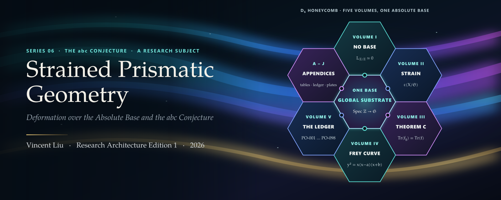
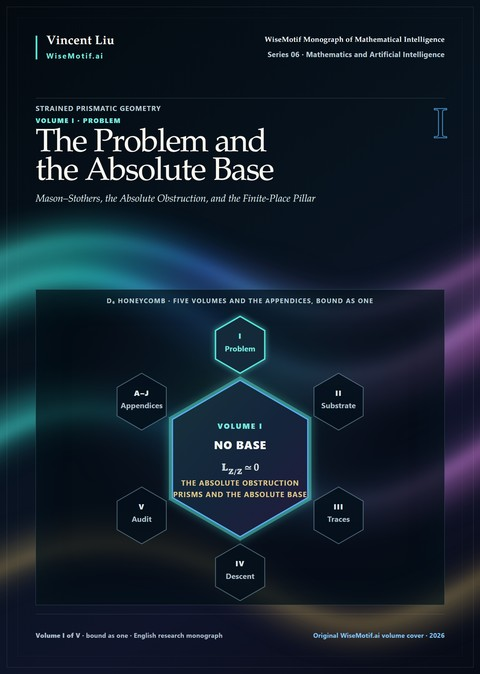
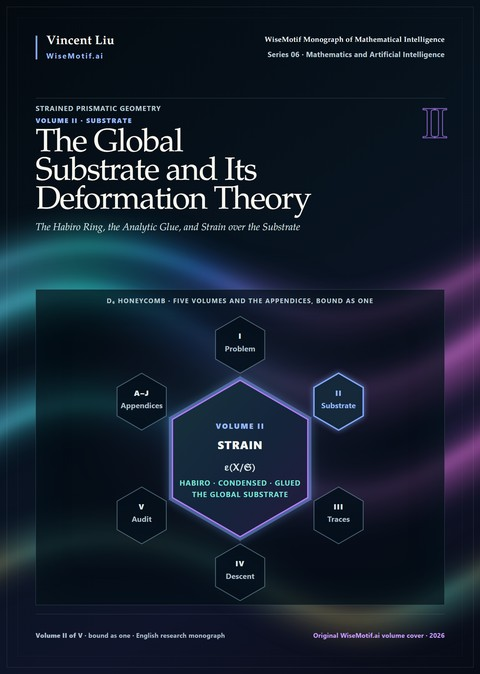
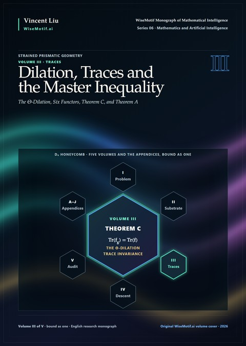
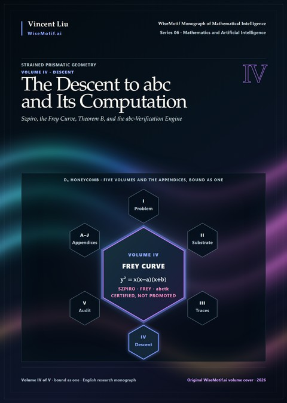
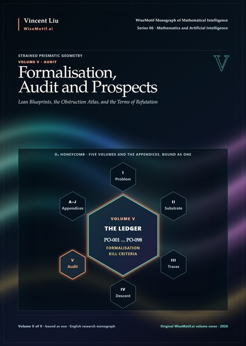
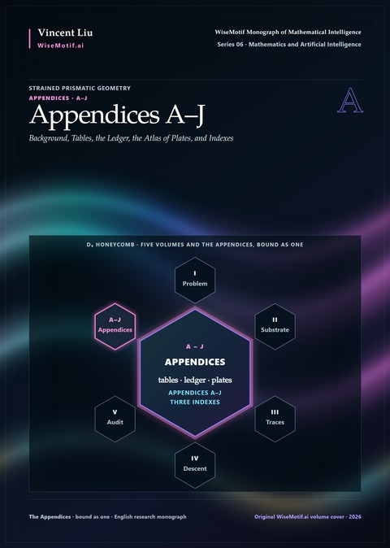
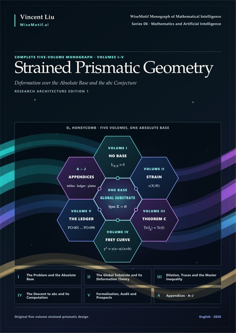

<p align="center">
  <a href="https://doi.org/10.5281/zenodo.23610034"></a>
</p>

<p align="center">
  <a href="https://doi.org/10.5281/zenodo.23610034"></a>
  <a href="https://creativecommons.org/licenses/by-nc-nd/4.0/deed.zh-hans"></a>
  <a href="code/LICENSE"></a>
  <a href="https://github.com/AlienMuse/strained-prismatic-geometry/releases/tag/v1.0.0"></a>
  
  
  
  <a href="VERIFY.md"></a>
  <a href="VERIFY.md"></a>
</p>

<p align="center">
  <b><a href="https://github.com/AlienMuse/strained-prismatic-geometry/releases/download/v1.0.0/Strained-Prismatic-Geometry-v1.0.0-Preview.pdf">阅读预览版</a></b>（166 页，72.0 MB）·
  <a href="#下载">下载</a> ·
  <a href="#五卷">五卷</a> ·
  <a href="#随书代码">代码</a> ·
  <a href="#引用">引用</a> ·
  <a href="VERIFY.md">校验</a> ·
  <a href="README.md">English</a>
</p>

<br>

# Strained Prismatic Geometry

Vincent Liu · Research Architecture Edition 1 · 2026 · [English](README.md)

> *整数环在交换含幺环中是初始对象，Spec ℤ 在概形中是终对象。因此通常的算术在 Spec ℤ 之下没有内在的底方向。*
> <br>— Preface

《Strained Prismatic Geometry — Deformation over the Absolute Base and the abc Conjecture》是一部五卷合一的专著
（正文为英文），共 1,666 页。它是 WiseMotif Monograph of Mathematical Intelligence 的第六部著作，属于
Grothendieckian Programme，但自成独立体系：它是该 Programme 的研究课题之一——在一个问题上把 Programme 的方法，即
递归式数学发现（recursive mathematical discovery），完整地走一遍：提出结构，用答案已知的情形检验它，把经受住检验的
部分抽象出来，再在新的层次上重新提出问题，正如 Grothendieck 的"上涨的海"（rising sea）。

所选的问题是 Masser 与 Oesterlé 的 abc 猜想。本书追问：**为什么它在函数域上是一个半页就能证明的定理，在整数上却仍未
解决？什么样的对象能让函数域上的证明在算术中得以仿照，而不只是被欣赏？**

**abc 猜想仍未解决。本书没有证明它。** 本书不是对宇宙际 Teichmüller 理论（inter-universal Teichmüller theory）的阐述、
验证、反驳或重述；关于该理论已公开的争议，本书只记录、不裁决。本书给出的是：把方法毫不让步地用到底之后问题所处的
状态——这个基底会给出什么、需要什么、每条通往它的路线停在哪里。

<table>
  <tr>
    <td align="center"><b>5</b><br><sub>卷，<br>合为一册</sub></td>
    <td align="center"><b>10 · 62</b><br><sub>部 ·<br>章</sub></td>
    <td align="center"><b>1,666</b><br><sub>页</sub></td>
    <td align="center"><b>98</b><br><sub>项具名<br>待证义务</sub></td>
    <td align="center"><b>14 · 22</b><br><sub>个障碍 ·<br>项判决性实验</sub></td>
    <td align="center"><b>186 · 242</b><br><sub>幅矢量 plate ·<br>条参考文献</sub></td>
    <td align="center"><b>61</b><br><sub>项 abctk<br>测试</sub></td>
  </tr>
</table>

## 核心思想：给 Spec ℤ 一个底

在函数域上，Mason 与 Stothers 的多项式 abc 定理之所以容易，是因为证明建立在一个底之上：沿底求导，再由
Riemann–Hurwitz 公式数出导数看到的东西。这个证明用到四样东西——一个底、沿底的导子、非零的相对微分层、一个次数–分歧
公式（第 2 章）。在 ℤ 上这四样东西出于同一个原因全部失效：ℤ 是交换环中的初始对象，所以 Spec ℤ 在它唯一的底上的余切
复形为零；而且**任何保留 ℤ 的初始提升的 1-范畴修补都改变不了这一点**（Obstruction 3.3.2，初始提升的不可行定理）。

本书换掉的是底。**整体基底**（global substrate）𝔖 由三部分沿乘积公式粘合而成：每个有限素数处的 prismatic 几何与
Cartier–Witt 栈、一次性覆盖所有素数的 Habiro 环上的 q-形变、实位处的 condensed 解析几何。于是 Spec ℤ → 𝔖 带有一个
相对余切方向，坏约化成为沿这个方向的**应变**（strain）：应变复形、应变类和算术 Kodaira–Spencer 类，其函数域极限
就是经典的 Kodaira–Spencer 映射。

| 方法 | 本书所做的 |
|---|---|
| **诊断** | Mason–Stothers 定理的三种证明、绝对障碍及其不可行定理、八条设计要求、六十年来各种替代方案按这些要求逐一评分（Part 0） |
| **构造** | δ-环、prism、Cartier–Witt 栈与 syntomic 栈、绝对底 𝔄；Habiro 环、condensed 与解析几何、整体基底 𝔖（Part I–II） |
| **形变** | 应变复形、算术 Kodaira–Spencer 类、log shell、Θ-线、粘合 ∞-广群 𝒢（Part III） |
| **伸缩** | Θ-伸缩 q ↦ q<sup>λ</sup>、带无条件解析核心的伸缩比较定理、作为下降的 multiradiality（Part IV） |
| **证明** | 定理 C：迹在恒同广群下不变，无条件成立（定理 36.3.1） |
| **下降** | 定理 A 主不等式（定理 39.1.6）与定理 B（ℚ 上的 abc，定理 43.1.5），均以具名义务为条件（Part V–VI） |
| **计算** | Habiro 与 prismatic 的认证算术、区间认证的迹基准、abc 验证引擎，由 abctk 实现（Part VII） |
| **审计** | Lean 4 蓝图、待证义务台账、障碍图谱、二十二项判决性实验与三条否决准则（Part VIII–IX） |

## 五卷

五卷与附录合为一册。下面每张封面把对应的卷放在 D₆ 蜂巢中心，并带有该格在全书封面上所写的公式。

<table>
  <tr>
    <td width="33%" valign="top" align="center">
      <a href="docs/contents/volume-i.md"></a><br>
      <b>I · The Problem and the Absolute Base</b><br>
      <sub>Part 0–I · 12 章 · 第 1–251 页</sub><br><br>
      <sub>Masser–Oesterlé 猜想的常数、有限性与质量三种形式；Mason–Stothers 定理的三种证明；绝对障碍与不可行定理；八条要求与替代方案图谱；δ-环与 Witt 向量、prism 与 prismatic 上同调、Cartier–Witt 栈与 syntomic 栈、F-gauge、Rees 下降、绝对底、Buium 的 jet 空间。</sub><br><br>
      <a href="docs/contents/volume-i.md">目录</a> · <a href="https://github.com/AlienMuse/strained-prismatic-geometry/releases/download/v1.0.0/Strained-Prismatic-Geometry-v1.0.0-Complete.pdf">PDF</a>
    </td>
    <td width="33%" valign="top" align="center">
      <a href="docs/contents/volume-ii.md"></a><br>
      <b>II · The Global Substrate and Its Deformation Theory</b><br>
      <sub>Part II–III · 14 章 · 第 252–549 页</sub><br><br>
      <sub>q-de Rham 上同调、Habiro 环与 Habiro 下降；condensed 数学、解析栈与阿基米德规范；沿乘积公式粘合的整体基底；adelic 曲线；应变复形、算术 Kodaira–Spencer 类、半稳定模型、log shell、Θ-线、粘合 ∞-广群与不定性演算。</sub><br><br>
      <a href="docs/contents/volume-ii.md">目录</a> · <a href="https://github.com/AlienMuse/strained-prismatic-geometry/releases/download/v1.0.0/Strained-Prismatic-Geometry-v1.0.0-Complete.pdf">PDF</a>
    </td>
    <td width="33%" valign="top" align="center">
      <a href="docs/contents/volume-iii.md"></a><br>
      <b>III · Dilation, Traces and the Master Inequality</b><br>
      <sub>Part IV–V · 14 章 · 第 550–841 页</sub><br><br>
      <sub>规范栈上的伸缩算子与 Θ-伸缩；函子性、伸缩比较定理、作为下降的 multiradiality、伸缩上闭链与刚性引理；六函子形式、范畴迹、定理 C、作为迹的高度、算术 Riemann–Hurwitz、主不等式及其常数。</sub><br><br>
      <a href="docs/contents/volume-iii.md">目录</a> · <a href="https://github.com/AlienMuse/strained-prismatic-geometry/releases/download/v1.0.0/Strained-Prismatic-Geometry-v1.0.0-Complete.pdf">PDF</a>
    </td>
  </tr>
  <tr>
    <td width="33%" valign="top" align="center">
      <a href="docs/contents/volume-iv.md"></a><br>
      <b>IV · The Descent to abc and Its Computation</b><br>
      <sub>Part VI–VII · 12 章 · 第 842–1100 页</sub><br><br>
      <sub>从主不等式到 Szpiro 猜想；Frey–Hellegouarch 曲线及其完整的 2-进分类；ℚ 上的定理 B、数域上的 abc、推论、一致性、极值三元组；Habiro 环中的认证计算、prismatic 算法、区间认证的迹、abc 验证引擎与可复现性约定。</sub><br><br>
      <a href="docs/contents/volume-iv.md">目录</a> · <a href="https://github.com/AlienMuse/strained-prismatic-geometry/releases/download/v1.0.0/Strained-Prismatic-Geometry-v1.0.0-Complete.pdf">PDF</a>
    </td>
    <td width="33%" valign="top" align="center">
      <a href="docs/contents/volume-v.md"></a><br>
      <b>V · Formalisation, Audit and Prospects</b><br>
      <sub>Part VIII–IX · 10 章 · 第 1101–1291 页</sub><br><br>
      <sub>基底与迹定理的 Lean 4 蓝图；作为形式工件的待证义务台账；多智能体方法与验证社会学；障碍图谱、可证伪性与否决准则、abc 之外的基底、已证与未证、未来十年的研究纲领。</sub><br><br>
      <a href="docs/contents/volume-v.md">目录</a> · <a href="https://github.com/AlienMuse/strained-prismatic-geometry/releases/download/v1.0.0/Strained-Prismatic-Geometry-v1.0.0-Complete.pdf">PDF</a>
    </td>
    <td width="33%" valign="top" align="center">
      <a href="docs/contents/appendices.md"></a><br>
      <b>Appendices A–J</b><br>
      <sub>10 个附录 · 参考文献 · 三种索引 · 第 1292–1599 页</sub><br><br>
      <sub>高阶范畴、condensed 与 pyknotic 数学、prismatic 汇编、δ-环表与 Habiro 环表、Arakelov 几何、术语表、待证义务台账、186 幅 plate 的图谱与计算资源；符号、人名与主题三种索引。</sub><br><br>
      <a href="docs/contents/appendices.md">目录</a> · <a href="https://github.com/AlienMuse/strained-prismatic-geometry/releases/download/v1.0.0/Strained-Prismatic-Geometry-v1.0.0-Complete.pdf">PDF</a>
    </td>
  </tr>
</table>

<p align="center">
  <a href="https://github.com/AlienMuse/strained-prismatic-geometry/releases/download/v1.0.0/Strained-Prismatic-Geometry-v1.0.0-Complete.pdf"></a><br>
  <b>全书合卷</b> · 第 I–V 卷与附录 A–J · 1,666 页 · 83.0 MB
</p>

## 主要结果

- **绝对障碍（Obstruction 3.3.2，初始提升的不可行定理）。** 对每一种保留 ℤ 的初始提升的 1-范畴代数修补，该提升的余切复形为零，并且到分裂平方零
  扩张的导子只有平凡的一个。*[NEW]*
- **迹不变性，定理 C（定理 36.3.1）。** 对于关于一个连通恒同 ∞-广群等变的可对偶对象自同态，其范畴迹是
  End(𝟏)<sup>h𝒢</sup> 中的一个典范点，与一切选择无关。它在基底上的实例是有条件的；该章写明它回应了 Scholze–Stix 质疑的
  哪一部分、哪些部分仍然成立。*[NEW]*
- **伸缩比较定理（定理 30.1.4）。** Θ-伸缩的有限位读数与阿基米德读数相差一个显式的 eta 商，并有无条件的界
  24(λ+1)|q|(1−|q|)<sup>−2</sup>；两条路线与基底构造的等同是有条件的。*[CONDITIONAL]*
- **主不等式，定理 A（定理 39.1.6）。** 应变迹不超过导子项与差积项之和的 (1+ε) 倍加上一个与对象无关的常数；论证分八步，
  其算术分量全部落在一项义务 PO-079 上。*[CONDITIONAL]*
- **带常数的"高度 Szpiro ⇒ abc"（定理 42.3.2）。** 指数为 6+δ 的高度形式 Szpiro 不等式给出指数为 1+δ/6、常数显式的 abc；
  加上用 Tate 算法重新证明的 Frey 曲线 2-进约化（定理 42.5.4，*[REPROVED]*），丢番图收尾部分是无条件的。*[NEW]*
- **ℚ 上的 abc，定理 B（定理 43.1.5）。** max(|a|,|b|,|c|) ≤ K<sub>B</sub>(ε) rad(abc)<sup>1+ε</sup>，以六十一项具名义务和
  三个具名假设为条件，每个常数都有追踪。*[CONDITIONAL]*
- **已证与未证（第 61 章）。** 定理 A、B 的依赖闭包作为一个显式有限集（命题 61.1.2）、无条件的数学内容（命题 61.1.9）、
  最值得立即怀疑的义务，以及具体的否决条件。

## 本书是什么——不是什么

**本书是**一个附上全部代价的基础性提案：对算术为何没有底的精确诊断；一个局部支柱都是既有数学、整体粘合是一份具名有限
义务清单的基底；一条无条件的迹不变性定理；一个每个常数都有追踪的 abc 条件推导；以及按其实际认证程度陈述的计算与形式
验证架构。每条实质性断言在出现处都带有六种标签之一：**[KNOWN]** 既有文献中的结果，**[REPROVED]** 在此重新证明的已知结果，
**[NEW]** 在此首次无条件证明，**[CONDITIONAL]** 由具名义务推出，**[OPEN]** 本书未证明，**[DISPUTED]** 记录但不裁决的公开争议。

**本书不是** abc 猜想的证明。定理 A 与定理 B 以附录 H 的台账为条件，书中凡出现它们之处都这样写明。本书不是对宇宙际
Teichmüller 理论的验证或反驳。这里没有任何程序计算应变迹：abctk 认证的是算术输入与显式比较目标，与应变迹的比较被记为
未解决（PO-087–PO-089）。

## 从哪里读起

路线取自 *Leitfaden*。

| 路线 | 章节 |
|---|---|
| 一个下午 | Epistemic Status、Leitfaden；3；5 与 61；39 与附录 H；59；55 |
| 通往定理 B 的最短依赖闭合路径 | 1–32、34–43，附录 A 与 F |
| 基础 | 1–18、20–25、27–28、34–36，附录 A |
| 计算与可复现性 | 1–32、34–52，附录 A 与 F |
| 怀疑者的审计 | 1–32、34–55、61，附录 A、F 与 H |

[预览版](https://github.com/AlienMuse/strained-prismatic-geometry/releases/download/v1.0.0/Strained-Prismatic-Geometry-v1.0.0-Preview.pdf) 包含前置部分——Series Note、Abstract、Preface、
Epistemic Status of This Book、Leitfaden、记号、目录，以及 plate、图与表的列表——和整个 Part 0。

## 系列

本书是 WiseMotif Monograph of Mathematical Intelligence 的第六部（Series 06），自成独立体系，是 Grothendieckian Programme 的第四个研究课题。系列的前两部紧密相连。从第三部起，每一部都是围绕一个问题自成体系的著作，在这个问题上把 Programme 的方法——递归式数学发现——完整地走一遍。整个 Programme 由其总纲 Series 00 阐述；总纲位于七部之前，不是七部之一。总纲与七部作品依次为：

<table>
  <tr>
    <td width="96" valign="top" align="center"><a href="https://github.com/AlienMuse/grothendieckian-programme"></a></td>
    <td valign="top"><b>Series 00 · <a href="https://github.com/AlienMuse/grothendieckian-programme"><i>The Grothendieckian Programme</i></a></b><br>
      <sub><i>Recursive Mathematical Discovery in the Age of Machine Reasoning</i></sub><br>
      Programme 的总纲：位于七部之前，不是七部之一；阐述 Programme 的思想、架构与七部的共同之处，不在七部之外增加任何数学结果。<br>
      <sub>一本书 · 53 页 · <a href="https://doi.org/10.5281/zenodo.23669107">doi:10.5281/zenodo.23669107</a></sub></td>
  </tr>
  <tr>
    <td width="96" valign="top" align="center"><a href="https://github.com/AlienMuse/grothendieckian-machine"></a></td>
    <td valign="top"><b>Series 01 · <a href="https://github.com/AlienMuse/grothendieckian-machine"><i>GAI-MUA: The Grothendieckian Machine</i></a></b><br>
      <sub><i>A Mathematical Universe Architecture for Verifiable and Self-Evolving Artificial Intelligence</i></sub><br>
      Programme 的核心部分：数学世界如何被构造、比较并从一个情境迁移到另一个情境，以及机器如何把它们作为有类型、有版本、可验证的对象来持有。<br>
      <sub>6 卷 · 14,905 页 · <a href="https://doi.org/10.5281/zenodo.23480696">doi:10.5281/zenodo.23480696</a></sub></td>
  </tr>
  <tr>
    <td width="96" valign="top" align="center"><a href="https://github.com/AlienMuse/topos-native-intelligence"></a></td>
    <td valign="top"><b>Series 02 · <a href="https://github.com/AlienMuse/topos-native-intelligence"><i>GM-Omega-Infinity: Topos-Native Intelligence</i></a></b><br>
      <sub><i>A Sheaf-Theoretic Architecture for Verifiable Machine Intelligence</i></sub><br>
      元推理内核：一个智能系统若要在这些世界内部推理，其内部必须是什么。<br>
      <sub>5 卷 · 4,020 页 · <a href="https://doi.org/10.5281/zenodo.23538544">doi:10.5281/zenodo.23538544</a></sub></td>
  </tr>
  <tr>
    <td width="96" valign="top" align="center"><a href="https://github.com/AlienMuse/arithmetic-spectral-descent"></a></td>
    <td valign="top"><b>Series 03 · <a href="https://github.com/AlienMuse/arithmetic-spectral-descent"><i>Arithmetic Spectral Descent</i></a></b><br>
      <sub><i>Obstruction Theory, Hodge–Krein Realization, and a Falsifiable Architecture for the Riemann Hypothesis</i></sub><br>
      研究课题 1：黎曼猜想。<br>
      <sub>4 卷 · 1,549 页 · <a href="https://doi.org/10.5281/zenodo.23564898">doi:10.5281/zenodo.23564898</a></sub></td>
  </tr>
  <tr>
    <td width="96" valign="top" align="center"><a href="https://github.com/AlienMuse/fractured-adelic-geometry"></a></td>
    <td valign="top"><b>Series 04 · <a href="https://github.com/AlienMuse/fractured-adelic-geometry"><i>Fractured Adelic Geometry</i></a></b><br>
      <sub><i>A Foundational Framework for the Birch and Swinnerton-Dyer Conjecture</i></sub><br>
      研究课题 2：Birch–Swinnerton-Dyer 猜想（BSD 猜想）。<br>
      <sub>4 卷 · 571 页 · <a href="https://doi.org/10.5281/zenodo.23585887">doi:10.5281/zenodo.23585887</a></sub></td>
  </tr>
  <tr>
    <td width="96" valign="top" align="center"><a href="https://github.com/AlienMuse/the-archimedean-prism"></a></td>
    <td valign="top"><b>Series 05 · <a href="https://github.com/AlienMuse/the-archimedean-prism"><i>The Archimedean Prism</i></a></b><br>
      <sub><i>Tame Period Geometry and the Hodge Conjecture</i></sub><br>
      研究课题 3：Hodge 猜想。<br>
      <sub>5 卷 · 1,309 页 · <a href="https://doi.org/10.5281/zenodo.23597954">doi:10.5281/zenodo.23597954</a></sub></td>
  </tr>
  <tr>
    <td width="96" valign="top" align="center"></td>
    <td valign="top"><b>Series 06 · <i>Strained Prismatic Geometry</i></b>（本书）<br>
      <sub><i>Deformation over the Absolute Base and the abc Conjecture</i></sub><br>
      研究课题 4：abc 猜想。<br>
      <sub>5 卷 · 1,666 页 · <a href="https://doi.org/10.5281/zenodo.23610034">doi:10.5281/zenodo.23610034</a></sub></td>
  </tr>
  <tr>
    <td width="96" valign="top" align="center"><a href="https://github.com/AlienMuse/the-arithmetic-topos"></a></td>
    <td valign="top"><b>Series 07 · <a href="https://github.com/AlienMuse/the-arithmetic-topos"><i>The Arithmetic Topos</i></a></b><br>
      <sub><i>Foundations of a Trace-Theoretic Approach to the Langlands Programme</i></sub><br>
      研究课题 5：Langlands 纲领。<br>
      <sub>5 卷 · 2,001 页 · <a href="https://doi.org/10.5281/zenodo.23629681">doi:10.5281/zenodo.23629681</a></sub></td>
  </tr>
</table>

## 下载

| 文件 | 页数 | 大小 |
|---|---:|---:|
| [**全书合卷**](https://github.com/AlienMuse/strained-prismatic-geometry/releases/download/v1.0.0/Strained-Prismatic-Geometry-v1.0.0-Complete.pdf)——第 I–V 卷与附录 A–J | 1,666 | 83.0 MB |
| [预览版](https://github.com/AlienMuse/strained-prismatic-geometry/releases/download/v1.0.0/Strained-Prismatic-Geometry-v1.0.0-Preview.pdf)——前置部分与 Part 0 | 166 | 72.0 MB |
| [随书代码](https://github.com/AlienMuse/strained-prismatic-geometry/releases/download/v1.0.0/Strained-Prismatic-Geometry-v1.0.0-code.zip)——abctk，Apache-2.0 | — | 60.7 KB |

相同文件（校验值相同）存档于 Zenodo：[doi:10.5281/zenodo.23610035](https://doi.org/10.5281/zenodo.23610035)。封面为 600 ppi 全出血；全部字体已嵌入；
PDF 已线性化，便于快速打开。

## 随书代码

[`code/`](code/) 是本书的认证算术核心 abctk，与 Release 中的代码包相同：整数根基与筛法、abc 三元组及其质量、
Frey–Hellegouarch 曲线与 Tate 算法、函数域 abc 定理、q-演算与精确 Habiro 位、截断 Witt 向量与 Nygaard 数据、高度、
向外舍入的区间证书，以及带规范化、内容寻址报告的 SQLite 引擎。它只用 Python 标准库；61 项测试每一项都断言书中印出的
一个陈述，`examples/generate_ch50_51.py` 重新生成第 50–51 章的全部数据。代码以 Apache License 2.0 授权
（[code/LICENSE](code/LICENSE)），书本身不是。

```sh
cd code/python
python -m pytest tests -q                  # 全部 61 项测试（需要 pytest）
python examples/generate_ch50_51.py        # 重新生成第 50–51 章的数据
```

## 引用

> Liu, V. (2026). *Strained Prismatic Geometry — Deformation over the Absolute Base and the abc Conjecture*
> (Research Architecture Edition 1, version 1.0.0). Zenodo. https://doi.org/10.5281/zenodo.23610034

```bibtex
@book{liu2026strainedprismatic,
  author    = {Liu, Vincent},
  title     = {Strained Prismatic Geometry --- Deformation over the Absolute Base and the {abc} Conjecture},
  series    = {WiseMotif Monograph of Mathematical Intelligence, Series 06},
  edition   = {Research Architecture Edition 1},
  version   = {1.0.0},
  year      = {2026},
  publisher = {Zenodo},
  doi       = {10.5281/zenodo.23610034},
  url       = {https://doi.org/10.5281/zenodo.23610034}
}
```

GitHub 的 *Cite this repository* 按钮使用 [CITATION.cff](CITATION.cff)。概念 DOI 10.5281/zenodo.23610034 始终指向最新版本；引用这些
确切文件时请用版本 DOI 10.5281/zenodo.23610035。

## 真实性

Release 的每个文件都列在 `SHA256SUMS` 中，经 OpenPGP 签名，并有两重时间戳（RFC 3161 与比特币上的 OpenTimestamps）。
签名密钥与 Series 01–05 相同。

签名密钥指纹：`DA1A 1AEF D8B2 C17C FF3F 1D1B 3905 0F50 7A4F EC17`

本仓库的 GitHub Release 不可更改。从别处获得、与 `SHA256SUMS` 不符的副本不是真本。三级校验方法见 [VERIFY.md](VERIFY.md)。

## 许可与 AI 使用

本作品采用 [知识共享 署名-非商业性使用-禁止演绎 4.0 国际许可协议](LICENSE)（CC BY-NC-ND 4.0）：您可以在注明作者、
非商业使用的前提下分享未经修改的副本。翻译及其他用途需获得书面许可。如版权页所述，书中印出的代码清单与 abctk 另以
[Apache License 2.0](LICENSES/Apache-2.0.txt) 授权。详见 [NOTICE.md](NOTICE.md) 与 [TRADEMARKS.md](TRADEMARKS.md)。

**文本与数据挖掘权利依欧盟指令 2019/790 第 4(3) 条予以保留。** 未经书面许可，不得用本作品训练或微调机器学习模型。
个人读者可以使用 AI 工具阅读、检索、讲解或翻译本作品以供自学。完整政策见 [TDM-AND-AI-POLICY.md](TDM-AND-AI-POLICY.md)。

## 参与

本书的 Epistemic Status 写得很直白：最有价值的回应不是赞同，而是证明某项义务为假、某条声明的依赖是循环的、第 59 章的
某项计算结果相反，或某个标为 [NEW] 的证明合不上。最重要的三类贡献：

- **反驳**——第 59 章二十二项判决性实验或三条否决准则中的任何一项，或附录 H 台账中的一项假义务。
- **构造**——九十八项义务 PO-001–PO-098 中任何一项的证明，从第 61 章列为最承重的那些开始。
- **复现**——用书中表格独立检验 abctk，或给出第 53–55 章某项义务的 Lean 陈述。

请通过 [勘误 issue](https://github.com/AlienMuse/strained-prismatic-geometry/issues/new?template=errata.yml) 报告错误。被采纳的更正将在下一版中署名致谢（见 [ERRATA.md](ERRATA.md)）。

---

<p align="center"><sub>
  <a href="https://wisemotif.ai">WiseMotif Monograph of Mathematical Intelligence</a> · Series 06 · Mathematics and Artificial Intelligence<br>
  Series 00：<a href="https://github.com/AlienMuse/grothendieckian-programme"><i>The Grothendieckian Programme</i></a> ·
  Series 01：<a href="https://github.com/AlienMuse/grothendieckian-machine"><i>GAI-MUA: The Grothendieckian Machine</i></a> ·
  Series 02：<a href="https://github.com/AlienMuse/topos-native-intelligence"><i>GM-Omega-Infinity: Topos-Native Intelligence</i></a> ·
  Series 03：<a href="https://github.com/AlienMuse/arithmetic-spectral-descent"><i>Arithmetic Spectral Descent</i></a> ·
  Series 04：<a href="https://github.com/AlienMuse/fractured-adelic-geometry"><i>Fractured Adelic Geometry</i></a> ·
  Series 05：<a href="https://github.com/AlienMuse/the-archimedean-prism"><i>The Archimedean Prism</i></a> ·
  Series 07：<a href="https://github.com/AlienMuse/the-arithmetic-topos"><i>The Arithmetic Topos</i></a><br>
  © 2026 Vincent Liu
</sub></p>
